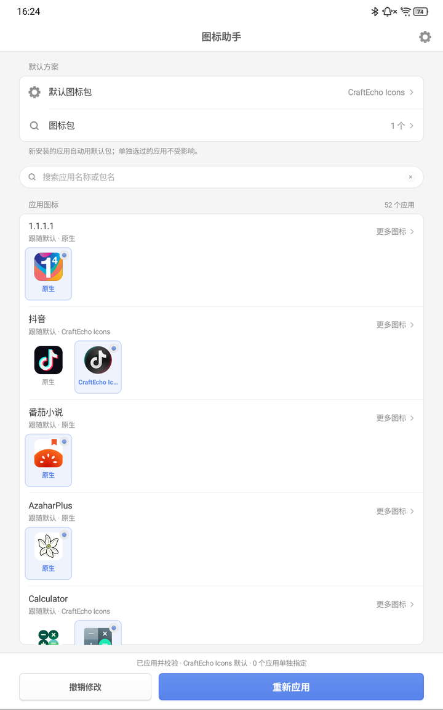
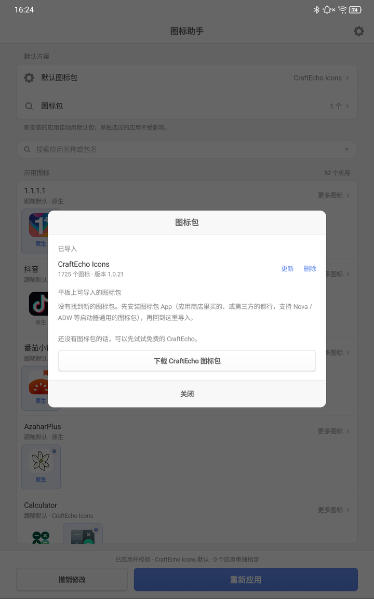
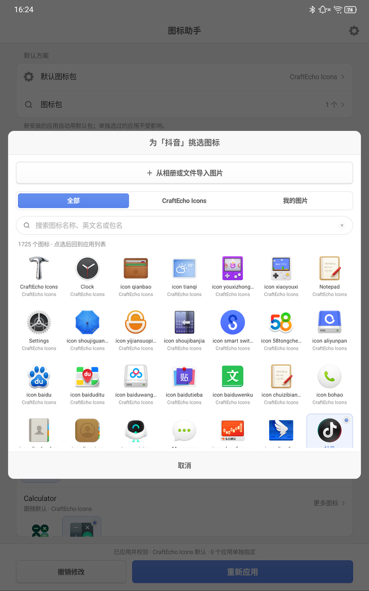

# ZUI 图标助手

给联想 ZUI 平板的**原厂桌面**换图标。不用 root，不用换第三方桌面，壁纸和桌面布局都不动。

<p align="center"></p>

## 它能做什么

- **导入图标包**：把你装在平板上的图标包（应用商店里买的、免费的、第三方的都行）导入进来，直接用在原厂桌面上。
- **一键换整套**：选一个默认图标包，它收录的应用全部换掉；以后新装的应用也会自动配上。
- **每个应用单独挑**：同一个应用可以在不同图标包之间挑一个最顺眼的，也可以用你自己的图片。
- **随时还原**：一键恢复出厂图标。

## 适用设备

已在 **联想拯救者平板 Y700 三代（TB321FU，ZUI 17.5，Android 16）** 上测试。

其他运行 ZUI 的联想平板/手机也可能可以用，但没有测试过。助手打开时会自己检查，用不了会直接提示，不会改动任何东西。

## 安装

到 [Releases](../../releases/latest) 下载最新的 `zui-icon-helper-*.apk`，在平板上打开安装即可（如果提示“未知来源”，按提示允许一次）。

## 第一次使用

### 1. 先装一个图标包

助手本身**不带任何图标**（图标都有版权，不能随便打包分发），需要你先在平板上装一个图标包 App：

- **买过的图标包**：直接从应用商店装上就行。
- **第三方图标包**：拿到 APK 后安装即可。只要是支持 Nova、ADW 等桌面的通用图标包都可以。
- **还没有图标包？** 可以先试试免费的 [CraftEcho Icons](https://github.com/gaodeng/CraftEcho-Icons/releases/latest)（锤子风格，下载那个 `.apk` 安装）。

> 图标包 App 装上后不用打开它，也不用设置它，回到助手导入就好。

### 2. 在助手里导入

打开「ZUI 图标助手」→ 点 **图标包** → 在“平板上可导入的图标包”里点 **导入**。

图标多的包（上千个）需要一两分钟，导入时别离开助手。导入完成后，图标包 App 卸不卸载都不影响已经导入的内容（想以后更新就留着）。

<p align="center"></p>

### 3. 选默认图标包，然后应用

点 **默认图标包**，选刚才导入的那一个，再点底部的 **应用选择**。几秒钟后桌面图标就换好了。

## 单独换某个应用的图标

主界面每一行是一个应用，下面一排是它能用的所有样子：

- 点一个预览就是选中它（浅蓝底、右上角带蓝色小勾）。
- 点 **更多图标**，可以在所有导入的图标包里搜索、随便挑一个。
- 在“更多图标”里点 **从相册或文件导入图片**，可以用你自己的图片：拖动、缩放、旋转调整好，透明背景会保留。
- 点 **跟随默认**，就取消这个应用的单独选择。

选完记得点底部的 **应用选择**，桌面才会变。

<p align="center"></p>

## 恢复原样

右上角 **设置 → 恢复系统原始图标**。会回到当前主题出厂时的图标，壁纸和布局不变。

## 常见问题

**为什么不直接自带一些图标？**
图标包的图片属于原作者，随便打包分发会侵权。所以助手只负责“导入你自己装的图标包”，图片只在你的平板上转换使用，不会上传到任何地方。

**日历和时钟的图标换不掉？**
ZUI 的原厂桌面会把 Google 日历、Google 时钟显示成动态图标（显示当天日期、走动的指针），这两个是桌面直接画的，主题换不了。

**浏览器“添加到主屏幕”的网页快捷方式换不掉？**
那种是快捷方式，不是应用，系统主题管不到它。

**在系统设置里换了主题之后，图标变回去了？**
换主题会重置图标。回到助手点一次 **应用选择** 就好。

**会不会把系统改坏？**
助手只替换当前主题里的图标文件。应用时如果出了问题，会自动退回之前的状态；任何时候都能一键恢复原始图标。如果平板上有多个用户，图标的变化可能对其他用户也生效。

**某个应用在图标包里明明有，却没换上？**
少数系统应用会和别的应用共用同一张图标，ZUI 不允许它们分开设置，助手会提示。另外图标包的作者可能没收录这个应用，可以用“更多图标”手动挑一个。

## 致谢与许可

- 界面风格参考 [Smartisan OS UI Kit (Unofficial)](https://www.figma.com/community/file/1419385240874679870)，作者 Paix Chan，[CC BY 4.0](https://creativecommons.org/licenses/by/4.0/)。
- 本项目代码以 [MIT](LICENSE) 许可开源。
- 本项目与联想、锤子科技及任何图标包作者均无关联。各应用图标与商标归其所有者所有。

<details>
<summary>自己编译</summary>

只需要 JDK 17+ 和 Android SDK（platforms 与 build-tools），不用 Gradle：

```bash
./app/build.sh
```

生成的 APK 在 `app/build/zui-icon-helper.apk`。不设置签名环境变量时会用临时调试密钥签名。
</details>
